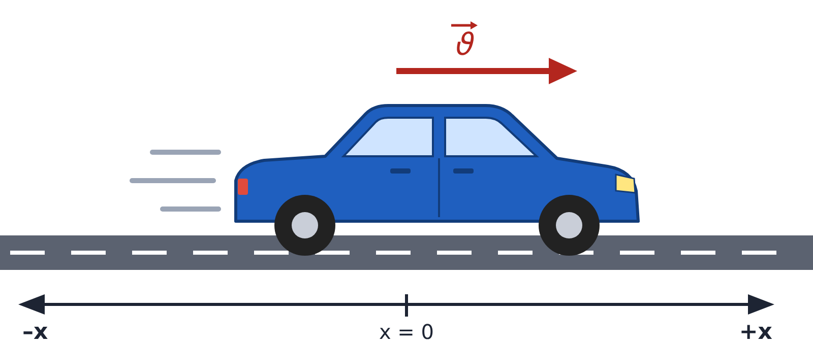
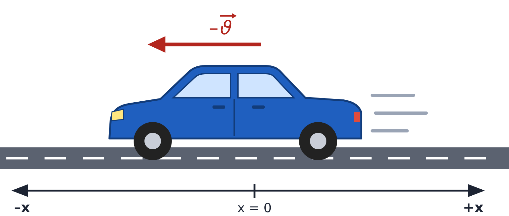

# Görsel Kütüphanesi

Ders materyallerinde (özet, çalışma yaprağı, sunum, sınav) tekrar kullanılabilecek fizik görselleri.
Gösterimler MEB 10. Sınıf Fizik Ders Kitabı (Türkiye Yüzyılı Maarif Modeli) ile uyumludur (hız: ϑ⃗).

Her görselin iki hâli vardır:
- **.png** – Word, PowerPoint, çalışma yaprağı vb. içine doğrudan eklemek için (2x çözünürlük)
- **.svg** – Büyütünce bozulmayan, düzenlenebilir vektörel hâli

## Kuvvet ve Hareket

| Görsel | Dosya | Açıklama |
|---|---|---|
|  | `arac_pozitif_x` | +x yönünde hareket eden araç, hız vektörü ϑ⃗, –x / x = 0 / +x ekseni |
|  | `arac_negatif_x` | –x yönünde hareket eden araç, hız vektörü –ϑ⃗, –x / x = 0 / +x ekseni |

## Yeni görsel eklerken

1. SVG dosyasını bu klasöre koyun (`viewBox` tanımlı olmalı).
2. PNG'leri yeniden üretin (depo kökünden):
   ```
   NODE_PATH=$(npm root -g) node ozetler/gorseller/png_olustur.js
   ```
3. Yukarıdaki tabloya bir satır ekleyin.
